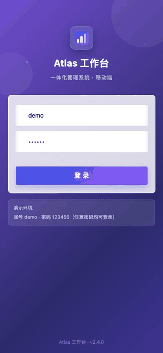

# Atlas 工作台 · 移动端

<p align="center">
  
</p>

一套面向「人事 / 费用 / 资产 / 档案 / 客户项目」的移动办公应用，覆盖申请、审批、台账查询与考勤打卡。
基于 **Taro 4 + Vue 3 + NutUI + TypeScript**，一份代码同时产出 **H5** 与 **微信小程序**。

> 演示项目：不含任何后端依赖，所有接口由内置数据引擎在本地生成，打开即可完整体验。

**在线体验** → <https://eggdanbo.github.io/atlas-admin-app/>


## 在线体验

<p align="center">
  
  <br>
  <sub>手机扫码直接打开 · 或访问 <a href="https://eggdanbo.github.io/atlas-admin-app/">eggdanbo.github.io/atlas-admin-app</a></sub>
</p>

## 项目概览

| 项 | 说明 |
| --- | --- |
| 页面 | 22 个页面：工作台 / 考勤规则 / 请假 / 打卡 / 通讯录 / 成员 / 看板 / 消息 / 我的 |
| 数据 | 本地引擎生成：待办、单据、审批流、成员、考勤与看板指标 |
| 请求 | 0 次真实网络请求，全部走本地适配器 |
| 端 | H5（浏览器）+ 微信小程序（产物已构建，开发者工具导入即可预览） |

## 界面预览

<p align="center">
  
</p>

<p align="center">
  <sub>登录 → 打卡 → 我的 → 个人信息 → 所属单位选择 · <a href="docs/screenshots.md">查看全部 53 张界面截图</a></sub>
</p>

## 功能模块

| 业务域 | 页面 | 说明 |
| --- | --- | --- |
| 工作台 | 首页 / 登录 | 问候与指标、去打卡 / 考勤规则、待办、8 个管理菜单 |
| 我的 | 个人中心 | 身份卡 + 今日打卡状态胶囊（未打卡 / 已上班 / 已完成）+ 本月考勤概览（出勤 / 迟到 / 加班）、账号与安全、关于应用（自定义弹窗：版本 / 运行环境 / 数据来源）、退出登录 |
| 我的 | 个人信息 | 头像即拍即换 + 资料完整度、姓名 / 手机号 / 所属单位（下钻选择）、身份证号 / 工号 / 登录账号、工作状态开关；行内校验、保存后同步个人中心与打卡 |
| 我的 | 人脸采集 | 状态卡（未采集 / 已采集 + 更新时间）、拍照 / 视频（活体）两种采集方式、拍摄要求与隐私说明；采集结果本地保存并同步「我的」采集状态 |
| 我的 | 修改密码 | 安全提示卡、旧密码 / 新密码 / 确认密码（可切换明文）、密码强度条、要求实时勾选；行内校验 + 旧密码核验（演示初始密码 123456） |
| 考勤 | 考勤规则（列表 / 详情 / 编辑） | 固定班次 / 自由打卡 / 排班制三种模式；多班次 + 各选工作日、弹性、自定义工时、按人排班表、打卡方式与范围、补卡次数；支持新建、修改、启停 |
| 考勤 | 打卡 / 打卡记录 / 考勤统计 | 班次打卡、月度明细、出勤与迟到统计 |
| 请假 | 请假申请（列表 + 新增） | 请假记录列表、状态筛选；悬浮按钮进表单，提交后回填列表 |
| 我的申请 | 单据列表 + 详情 | 全部申请单据：状态筛选、搜索、审批流程、撤回 |
| 组织 | 组织通讯录 / 成员管理 | 按部门分组可搜索；成员在职 / 停用状态与工号 |
| 数据 | 数据看板 | 待处理、单据量、通过率、近 7 日走势、部门与类型分布 |
| 协同 | 消息中心 | 待办 / 消息 / 通知，类型下拉筛选、关键字搜索、未读标记与一键已读；工作台「待办 → 查看全部」会带 `types=0` 直达并自动筛成待办 |

## 考勤规则 · 三种模式

参照企业微信 / 钉钉的考勤组建模，规则在一处切换模式，列表与详情按模式展示不同的摘要：

| 模式 | 适用场景 | 关键配置 | 判定方式 |
| --- | --- | --- | --- |
| 固定班次 | 总部、职能等作息统一的团队 | 可配多个班次，每个班次单独选工作日（工作日不能重复）、上下班时间、休息时段；弹性区间（15 / 30 / 60 分钟）规则级 | 按所排班次打卡，弹性区间内不算迟到 |
| 自由打卡 | 外勤、顾问、不坐班岗位 | 每日应出勤工时（自定义 0.5 - 24 小时）、工作日、每日打卡次数、最晚下班打卡 | 不判迟到早退，当日累计工时达标即正常 |
| 排班制 | 客服、门店、仓储等轮班团队 | 先建班次库（跨天自动判断），再按「人员 × 日期」排班，每人班次各不相同，时间冲突会被拦截 | 按当日个人班次上班，班次内打卡 |

列表卡片用彩色徽章区分模式，顶部统计「固定 / 自由 / 排班」各多少条；详情页班次时长按跨天自动 +24 小时计算。

固定班次的工作日在「班次设置」里按班次勾选：每个班次一排「一 ~ 日」多选，默认勾选周一到周五，
可以按「工作日班 + 周六值班」这种方式拆成多个班次。

**同一天只能属于一个班次**：新增班次时会自动勾选还没被占用的工作日（第一个班次占了周一至周五，
新班次就自动带上周六、周日）；已被其它班次选走的日子置灰不可点，点了提示「周一已被「标准班」占用」；
第一个班次选了周一至周五，第二个班次就只剩周六、周日可选。当 7 天全部排满时，
「+ 添加班次」会变成灰色的「7 天已排满，无法新增班次」，点击只提示、不会新增。
保存时还会再兜底校验一次工作日重复与时间冲突。

固定班次允许多个班次并存，但**前后班次的工作时间不能冲突**：校验会把「班次 + 工作日」铺到一周的时间轴上，
跨天班次（22:00 → 次日 06:00）占用次日的时段同样参与比较，冲突时提示到具体班次与星期。
自由打卡的工作日仍是规则级的一排多选（默认周一至周五，带「周一至周五 / 每天 / 清空」快捷操作）。

自由打卡的每日应出勤工时是一个整体的步进器：左侧减号、中间可直接输入数值（0.5 - 24 小时，如 7.5、11）、
右侧加号按 0.5 小时步进，输入框与按钮共用同一块控件，不会出现尺寸失衡或溢出卡片。

排班是「班次 → 人员 × 日期」的排班表：先建好班次（名称、起止时间），
再在表格里点选若干「人员 + 日期」单元格，选好班次（或「休息」）后点「确定」才写入，
避免误触直接落库；底部会实时提示「将 N 个单元格设为「早班」」。
左侧姓名列固定，右侧日期横向滚动；支持「周 / 月」两种视图与前后翻页；同一个人同一天再排会覆盖原班次。
点击表头的「N 人」可展开人员面板，勾选或取消参与排班的人员（取消会同时清掉 TA 的排班），已选人员置顶方便操作。

- **跨天自动判断**：下班时间不晚于上班时间即视为跨天（如 22:00 → 06:00），无需手动切换。
- **未加班次不可排班**：班次为空时不展示排班表，只提示「先在班次设置里添加班次，再给人员排班」。
- **时间冲突按连续时间轴校验**：同一天重叠会被拦截（早班 08:00-17:00 与中班 12:00-21:00）；
  跨天班次还会占用次日（1 号夜班 21:00 → 次日 07:00，2 号再排 06:00 的早班同样冲突），
  冲突日期跳过并提示冲突来源（同日 / 跨天占用），不重叠的班次可以叠加。
- **班次可多选**：底部一次勾选多个班次（如早班 + 晚班）再点「确定」一起排入；如果所选班次之间时间重叠，
  会提示「早班与中班时间重叠，请重新选择」并取消这次选择。
- **同一天可排多个班次**：只要时间不重叠就能叠加（格子显示「早班+1」），重叠会被拦截；
  成功后不再弹提示，只有冲突才提示。
- **一天不超过 24 小时**：同一人同一天所有班次（含跨天时长、扣除班次内休息）累计不能超过 24 小时，超出会提示并跳过。
- **班次自带休息时间**：排班制的每个班次可单独设休息时段（如 12:00-13:00），时长按扣除休息后计算。
- **休息时段跟着上下班走**：改上下班时间后，休息自动取班次中点前后各 30 分钟（09:00-18:00 → 13:00-14:00）；
  班次只有 1 小时及以下时不设休息；手动选休息时间只能在上下班之间，越界会提示并保持原值。
- **打开休息开关先校验时间**：休息关闭时不改动已选时间；重新打开会先检查上下班（下班需晚于上班、
  班次时长大于 1 小时），不满足则不开并提示先调整，满足则按当前上下班重新生成休息时段。
- **最小交接间隔**：排班规则可设 0 / 15 / 30 / 60 分钟。夜班 07:00 结束、次日班次 07:00 开始时，
  30 分钟规则下判定为冲突（提示「需间隔 30 分钟」），改为 0 才允许首尾相接。
- **休息时段自定义**：固定班次可自由选休息开始/结束时间（或直接关掉显示「不休息」），不再用预设选项。
- 某人被前一天跨天班次占用、当天又没排班时，对应格子显示橙色「续」；删除班次时会同步清掉该班次的排班。
- 排班人员按所选部门自动带出（新建规则时），排班表人数与规则人数一致。
- **适用部门改为下拉多选**：部门多时不再铺一屏标签，点开面板两列勾选，支持全选 / 清空。

## 个人信息

入口在「我的 → 账号与安全 → 个人信息」。页面按移动端资料卡的写法重做，不再是一列平铺的表单：

- **顶部个人卡**：头像（右下角「＋」即点即换）、姓名、工作中 / 免打扰状态胶囊、单位与工号，
  底部一条「资料完整度」进度条（姓名、手机号、单位、身份证号、工号、照片 6 项，改动即时刷新）。
- **分卡片编辑**：基本信息（姓名 / 手机号 / 所属单位）、其他信息（身份证号 / 工号 / 登录账号）、提醒设置（工作状态开关，
  说明文案随开关切换）。输入内容右对齐，与「我的」页的行式排版保持一致。
- **所属单位下钻选择**：底部面板按「全部 → 单位 → 部门」逐级下钻，面包屑可回退到任一层级，
  当前所在部门高亮并打勾；打开时直接定位到当前所选部门的同级，不用每次从根节点找。
- **行内校验**：姓名、手机号、所属单位必填；手机号按 1[3-9] 开头 11 位校验，身份证号选填但需 18 位，
  登录账号限制 3-30 位字母、数字或下划线。错误以红色下划线 + 行下提示呈现，同时弹一条提示说明首个问题。
- **保存即生效**：演示环境把改动写回本地用户，返回「我的」后头像、姓名、工号、单位同步更新；
  人员照片仅用于工作台展示，人脸识别照片仍在「人脸采集」中维护。

## 人脸采集

入口在「我的 → 账号与安全 → 人脸采集」，页面按「状态 → 方式 → 要求」重排：

- **状态卡**：未采集时虚线头像 + 「待采集」胶囊 + 三步流程条；已采集后换成真实照片、绿色「已启用」胶囊与
  「更新于 05-18 09:30」时间（时间取后台上次采集时间，只保留月日时分）。
- **两种采集方式**：拍照采集（`camera` 取景 → 快门 → 预览确认）与视频采集（H5 实时取景 + 活体检测，
  取景帧上传后登记）。H5 默认推荐视频采集，小程序端只保留拍照并注明「暂不支持」。
- **重新采集**：已有照片时按钮变「重新采集人脸」，点击先弹确认（避免误覆盖），确认后才拉起相机。
- **拍摄要求 / 隐私说明**：四条要求改成编号列表；隐私说明独立一张浅青色卡片，明确「仅用于考勤核验、加密存储、重采会覆盖」。
- **演示环境的行为**：`useCamera` 在 mock 下不再请求文件服务，直接把本地临时帧当作人脸照片；`updateface`
  把 `face_pic / face_url / face_utime` 写回内存用户，页面重新拉 `info` 与「我的」采集状态都会立即更新。

> 组件层面：`SpFaceCamera` 新增 `showIdle`（页面自带状态卡时关掉内置空态）并暴露 `startCamera`，
> 相机 / 预览 / 上传三段改为统一的深色全屏流程，预览页带「重新拍摄 / 确认上传」。

## 修改密码

入口在「我的 → 账号与安全 → 修改密码」，把原来的平铺 nut-form 换成两张卡片：

- **安全提示卡**：CSS 画的锁形图标 + 「账号安全」+ 当前账号与「建议每 3 个月更换」提示。
- **修改密码**：三行输入右对齐，每行带「显示 / 隐藏」切换；新密码下方实时显示强度条
  （弱 / 中 / 强，按长度、字母数字组合与 10 位以上三档计分）。
- **密码要求**：至少 6 位、同时包含字母与数字、与手机号 / 工号不重复，三条按输入实时打勾。
- **校验与提交**：旧密码必填、新密码不少于 6 位且不能与旧密码相同、两次输入需一致；
  错误行内提示并弹一条说明，成功后返回「我的」。mock 侧会校验旧密码（初始 `123456`），改密后同步更新。

## 管理菜单

首页 8 个入口按「管理端在手机上真正会做的事」重排，不再做员工自助入口的堆叠：

| 入口 | 页面 | 能力 |
| --- | --- | --- |
| 考勤规则 | `pages/rules/index` | 规则列表（模式徽章 / 班次或工时 / 打卡方式 / 启停），右下角悬浮按钮新建，卡片进详情可改可停用 |
| 我的申请 | `pages/apply/list` | 全部申请单据：状态下拉筛选、单号搜索 |
| 请假申请 | `pages/apply/leave` | 请假记录列表（参考「我的申请」），右下角悬浮按钮进请假 / 加班表单 |
| 组织通讯录 | `pages/contact/index` | 按部门分组，姓名 / 职位搜索，一键联系 |
| 成员管理 | `pages/team/index` | 在职 / 停用状态、工号、部门职位，按姓名或工号搜索 |
| 考勤统计 | `pages/checkin/stats` | 四项指标 + 近 7 个工作日工时柱状图 + 规则说明 |
| 数据看板 | `pages/board/index` | 待处理、单据量、通过率、7 日走势、部门与类型分布 |
| 消息中心 | `pages/user/message/index` | 待办 / 消息 / 通知，类型筛选（支持 `?types=0/1/2` 直达）、未读标记、一键已读 |

打卡记录不再占菜单位：它是打卡后的下一步，已放进「打卡 → 本月统计 → 查看记录」。

### 为什么这样精简

移动端的价值是「决策与确认」，不是「录入与配置」。所以：

| 留在 H5 / 小程序 | 留给 PC 后台 |
| --- | --- |
| 审批同意 / 驳回、单据查询与撤回、打卡 | 台账录入、批量导入导出 |
| 通讯录、成员状态查看、团队数据看板 | 报表设计、权限配置、组织建模 |
| 待办与消息触达 | 流程设计、字段与表单配置 |

入口按「考勤 → 单据 → 组织 → 数据 → 消息」排序，把规则配置这类高频维护动作放第一格；数据看板只做汇总与趋势，明细一律下钻到列表页。

## 技术栈

| 类别 | 选型 | 说明 |
| --- | --- | --- |
| 跨端 | Taro 4.2 | H5 + 微信小程序，分包加载 |
| 框架 | Vue 3.5 | `<script setup>` + Composition API |
| 语言 | TypeScript 5.7 | 严格模式 |
| UI | NutUI Taro 4.3 | 按需自动引入 + 主题变量覆盖 |
| 状态 | Pinia 4 | 认证、枚举、应用信息 |
| 请求 | Alova 3 | 自定义本地适配器，零网络请求 |
| 样式 | SCSS Modules | 设计令牌 + 组件级样式隔离 |
| 反馈 | SpToast | 全局提示组件，替代 `Taro.showToast`，按文案自动区分成功 / 失败 / 信息 |
| 日期 | date-fns 4 | 轻量、可 tree-shaking |

## 快速开始

```bash
pnpm install

# H5 开发（访问 http://localhost:5097/app/）
BROWSER=none pnpm dev:h5

# 微信小程序（微信开发者工具导入项目根目录）
pnpm dev:weapp
```

打开首页会先校验登录态，未登录自动进入登录页。演示账号：**demo / 123456**（任意密码均可登录）。

### 常用命令

```bash
pnpm dev:h5         # H5 开发
pnpm dev:weapp      # 小程序开发
pnpm build:h5       # H5 构建，产物 dist/atlas-admin-app
pnpm build:weapp    # 小程序构建
pnpm lint           # ESLint
pnpm lint:fix       # 自动修复
pnpm test:e2e       # Playwright E2E
```

## 本地数据引擎

没有后端也能把 48 个页面跑「像真的」，核心是三层：

```
页面 define.ts ──► scripts/mock/extract-schema.mjs ──► src/mock/schema.generated.ts
                                                              │
请求 ──► 自定义 Alova Adapter ──► src/mock/engine.ts ──► 结构化数据
```

1. **字段提取**：扫描 35 个页面的 `define.ts`，得到字段名、中文标题、列表/详情顺序，
   再从 `detail.vue` 提取明细表用到的字段，生成 `schema.generated.ts`（303 个字段）。
2. **确定性造数**：`FNV-1a + mulberry32`，种子为 `模块#行号`。
   同一模块每次刷新得到同一批数据；金额、日期、状态按字段语义生成，不会出现「金额是中文」。
3. **本地适配器**：替换 Alova 的 requestAdapter，按 URL 分派到认证、枚举、工作流、消息、
   组织、考勤或业务模块，返回标准 `{ code, data, message }`，永不发起网络请求。

重新生成字段结构：

```bash
node scripts/mock/extract-schema.mjs
```

## 目录结构

```
src/
├── app.config.ts            # 路由、分包、TabBar
├── components/              # 通用组件（见下方「组件清单」）
├── hooks/                   # useListPage / useAuthLoad / useEnum / useFilePreview ...
├── mock/
│   ├── engine.ts            # 本地接口引擎
│   ├── schema.generated.ts  # 页面字段结构（自动生成）
│   ├── datasets.ts          # 枚举、权限、待办、消息、考勤数据
│   ├── dict.ts              # 字段语义 → 值
│   └── random.ts            # 确定性伪随机
├── pages/                   # 21 个页面（生产），按业务域分包；开发态多一个内置文件预览页
├── service/
│   ├── api/                 # 各业务接口定义
│   └── http/                # Alova 实例与适配器
├── stores/                  # auth / enums / appinfo
├── styles/                  # 变量、主题、通用样式（sp- 工具类）
└── utils/                   # 路由、存储、权限、地图等
```

## 组件清单

页面里重复出现的结构都收在这几个组件里，改一处即可全站生效：

| 组件 | 作用 | 主要使用者 |
| --- | --- | --- |
| `AuthLayout` / `PageNavbar` | 登录守卫外壳 / 页面标题栏 | 全部业务页 |
| `SpCard` | 白卡容器：`title` + `hint` + 插槽，`variant="form"`（表单行）/ `"detail"`（标签-值行） | 个人信息、人脸、密码、申请详情、规则详情 |
| `SpFormRow` | 表单行：标签 + 必填星号 + 行内控件插槽 + 行下错误 / 成功提示 + 右侧箭头 | 个人信息、修改密码 |
| `SpKvRow` | 标签-值行：左灰标签 + 右对齐值，`strong` 强调数字 | 申请详情、规则详情 |
| `SpSearchBar` | 搜索框：放大镜图标 + 清除按钮 + `confirm` 事件，`inset` 控制左右留白 | 通讯录、成员管理、消息、规则、我的申请 |
| `SpFilterSelect` | 下拉筛选：触发器 + 选项面板 + 点击空白关闭 | 消息中心、我的申请 / 请假 |
| `SpListStatus` | 列表四态：首屏加载 / 空态 / 加载更多 / 没有更多 | 所有分页列表 |
| `SpEmpty` | 空态插画 | 列表与详情 |
| `SpToast` / `SpSliderCaptcha` / `Watermark` | 轻提示 / 滑块验证 / 水印 | 全局 |
| `SpFaceCamera` | 人脸采集：取景 → 预览 → 上传三段全屏流程 | 人脸采集 |
| `File` / `FileUpload` | 文件选择与上传（含 `useFileUpload` / `useFilePreview`） | 个人信息头像、人脸 |

> 组件的 `data-role`（如 `card-title` / `filter-option` / `form-error`）是给 E2E 用的稳定锚点，
> 不依赖 CSS Module 的哈希前缀，改样式不会打断用例。

## 品牌与设计

- 主色 `#4f46e5`，品牌渐变 `#3b4fe0 → #8b5cf6`，强调色 `#5eead4`。
- 登录页、工作台、我的页统一使用品牌标识（三根递增柱 + 薄荷绿高亮）。
- 状态色：成功 `#16a34a`、警示 `#f59e0b`、错误 `#dc2626`。
- TabBar 图标由 `scripts/generate-tab-icons.py` 生成，灰 / 品牌紫两套。

## 布局与滚动（H5）

Taro 的 H5 采用「外层定高 + 内层滚动」：

```
html / body → .taro-tabbar__container → .taro-tabbar__panel（让出 tabBar 高度）
            → #app（router） → .taro_page（滚动容器，overflow-y: auto）
```

约定（见 `src/app.scss`）：

- `html / body / .taro-tabbar__container / #app` 统一 `height: 100%`，**不用 `100vh`**：
  移动端地址栏展开时 `100vh` 指的是「地址栏收起后」的高度，比真实可视高度大，
  底部 tabBar 会被顶出屏幕且无法滚动到底。
- 页面内容的滚动交给 `.taro_page`，并设置 `overscroll-behavior-y: contain`，
  避免滚到边界时触发整页回弹 / 下拉刷新。
- 页面根节点统一用 `.sp-page`：普通页面 `min-height: 100dvh`（容器就是整个视口）；
  带 tabBar 的页面用 `.taro_tabbar_page .sp-page { min-height: calc(100dvh - 50PX) }`。
  两者必须区分——容器已经扣掉了 tabBar 的 50px，若仍按视口高度撑满，每页都会多出
  一段「滚一下就弹回、又看不到内容」的虚假滚动。
- `50PX` 的大写写法是刻意的：Taro 的 `px → rem` 只转换小写 `px`，tabBar 高度必须是物理像素。
- 固定底部操作栏 / 悬浮按钮的页面，用 `.sp-page--with-bar`（预留 150px）或
  `.sp-page--with-fab`（预留 200px）在页面级留白，两者都带 `safe-area-inset-bottom`。
  这两个类选择器写成 `.sp-page.sp-page--with-bar` 提高优先级：页面自身的 `.page` 常写
  `padding` 简写，同优先级下会把预留高度覆盖掉，最后一块内容就被固定按钮压住了。

> 排查提示：如果在 DevTools 里「模拟机型高度 > 浏览器窗口高度」（例如 iPhone 16 Pro Max
> 956px 的机型放在 830px 高的窗口里），浏览器会把页面底部直接裁掉——此时页面本身并没
> 有溢出（内容高度小于模拟视口），所以「滑不动」是裁剪造成的。把窗口拉高、或在设备
> 工具栏里选一个更矮的机型即可。

## 登录与守卫

- 打开首页先校验登录态，未登录 `reLaunch` 到登录页；演示账号 **demo / 123456**。
- **所有平台表现一致**：普通浏览器、微信 / 企业微信内置浏览器、小程序，未登录都进登录页。
  微信环境下同样显示账号密码表单——演示环境没有真实 OAuth，否则进去只能看到一句提示。
- 守卫带 **8 秒冷却**：短时间内重复触发即判定为回环，停在未登录引导，不再跳。
  历史坑：登录页 `ensureKey()` 在微信 / 企微分支会 `window.location.href` 整页跳回根路径，
  与首页守卫叠加后形成「首页 → 登录页 → 首页」的无限刷新（3 秒上百次），已在 `auth.ts` 中移除。
- 回归用例：`e2e/wechat-guard.spec.ts`（微信 / 企微 UA，断言跳转次数有限且能完成登录）。

## 说明与边界

- **纯前端演示**：无服务端、无真实账号体系，数据均为虚构。
- **小程序**：`project.config.json` 使用 `touristappid`，可直接以游客模式预览；
  正式发布需替换为自己的 AppID。
- **外部能力**：人脸活体、地图瓦片、文件预览依赖三方服务，演示环境已降级或跳过，
  不影响页面浏览与流程演示。
- **H5 部署**：路由与静态资源均挂在 `/app/` 下（`TARO_APP_H5_BASENAME`），
  如需部署到子路径，修改该变量后重新构建。

## License

MIT
